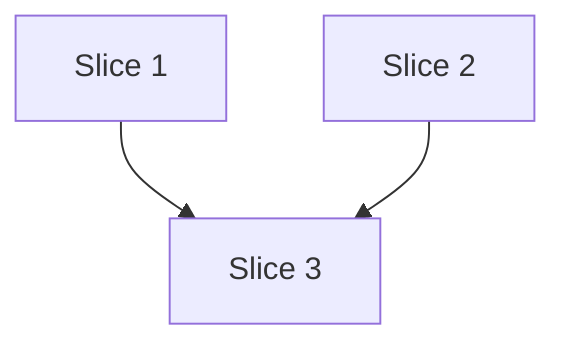

# Plan: `audit-log` CLI filters and JSON output

**Created**: 2026-11-10
**Branch**: feat/audit-log-cli
**Status**: draft
**Gherkin persistence**: plan-file-only

## Goal

Operators pipe `audit-log list` into scripts, but it prints only a text table
and always lists every entry. Add a `--since` filter and a `--json` output mode.

## Acceptance Criteria

- [ ] AC1: `format_json(entries)` returns a JSON array with one object per entry holding `ts`, `actor`, `action`.
- [ ] AC2: `filter_since(entries, since)` keeps only entries with `ts >= since`; an unparseable `since` raises `ValueError`.
- [ ] AC3: `audit-log list --since 2026-11-01 --json` prints the filtered entries as JSON; without `--json` it prints the existing table.

## Slices

### Slice 1: JSON formatter

**Depends-on:** none
**Files:** `audit_log/format_json.py`, `tests/test_format_json.py`

**Behavior:**

```gherkin
Feature: JSON formatting

  Scenario: Entries become a JSON array
    # Still passes if: keys are emitted in a different order
    Given two audit entries by "dana" and "lee"
    When the entries are formatted as JSON
    Then the output is a JSON array of 2 objects with actors "dana" and "lee"
```

**Steps:**

#### Step 1.1: `format_json`

**Complexity**: standard
**IMPLEMENT**: Pure function `format_json(entries) -> str`
**TEST**: Zero entries gives `[]`; two entries give two objects with `ts`, `actor`, `action`
**REFACTOR**: Reuse the existing `Entry.as_dict()`
**Files**: `audit_log/format_json.py`, `tests/test_format_json.py`
**Covers**: AC1
**Commit**: `feat(audit-log): add JSON formatter`

### Slice 2: Since filter

**Depends-on:** none
**Files:** `audit_log/filters.py`, `tests/test_filters.py`

**Behavior:**

```gherkin
Feature: Since filter

  Scenario: Older entries are dropped
    # Still passes if: entries are returned in reverse order
    Given entries at 2026-10-31 and 2026-11-01
    When entries are filtered since 2026-11-01
    Then only the 2026-11-01 entry remains

  Scenario: Bad date is rejected
    # Still passes if: the error message wording changes
    When entries are filtered since "yesterday-ish"
    Then the filter fails with a ValueError
```

**Steps:**

#### Step 2.1: `filter_since`

**Complexity**: standard
**IMPLEMENT**: Pure function `filter_since(entries, since: str)` parsing ISO dates
**TEST**: Boundary entry kept, earlier entry dropped, bad date raises
**REFACTOR**: Name the parse helper `parse_day`
**Files**: `audit_log/filters.py`, `tests/test_filters.py`
**Covers**: AC2
**Commit**: `feat(audit-log): add since filter`

### Slice 3: Wire flags into the CLI

**Depends-on:** 1, 2
**Files:** `audit_log/cli.py`, `tests/test_cli.py`

**Behavior:**

```gherkin
Feature: CLI flags

  Scenario: Filtered JSON listing
    # Still passes if: the table output's column widths change
    Given entries at 2026-10-31 and 2026-11-01
    When the operator runs "audit-log list --since 2026-11-01 --json"
    Then stdout is a JSON array holding only the 2026-11-01 entry
```

**Steps:**

#### Step 3.1: Add `--since` and `--json`

**Complexity**: standard
**IMPLEMENT**: Add both flags to the `list` subparser; call `filter_since` then `format_json` or the existing table
**TEST**: Run `main(["list", "--since", "2026-11-01", "--json"])` and parse stdout
**REFACTOR**: Extract `render(entries, as_json)`
**Files**: `audit_log/cli.py`, `tests/test_cli.py`
**Covers**: AC3
**Commit**: `feat(audit-log): add --since and --json flags`

## Parallelization



| Wave | Slices (parallel) |
|------|-------------------|
| 1 | 1, 2 |
| 2 | 3 |
