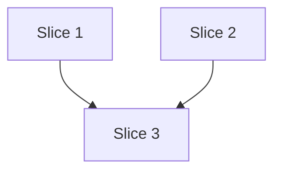

# Plan: Account settings pages

**Created**: 2026-11-08
**Branch**: feat/account-settings
**Status**: draft
**Gherkin persistence**: plan-file-only

## Goal

Users cannot change their display name or notification preferences without
contacting support. Add two settings pages under `/account`.

## Acceptance Criteria

- [ ] AC1: `/account/profile` lets a signed-in user change their display name (1-40 characters).
- [ ] AC2: `/account/notifications` lets a signed-in user toggle email and SMS notifications.
- [ ] AC3: Both pages redirect a signed-out visitor to `/login`.

## Slices

### Slice 1: Profile page

**Depends-on:** none
**Files:** `src/pages/account/Profile.tsx`, `src/pages/account/Profile.test.tsx`, `src/routes.tsx`

**Behavior:**

```gherkin
Feature: Profile settings

  Scenario: Change display name
    # Still passes if: the success toast text changes
    Given a signed-in user "dana" with display name "Dana"
    When "dana" saves display name "Dana K"
    Then the profile page shows display name "Dana K"
```

**Steps:**

#### Step 1.1: Profile page and route

**Complexity**: standard
**IMPLEMENT**: Add `Profile.tsx`; register `/account/profile` as an authenticated route in `src/routes.tsx`
**TEST**: Render the route signed in and signed out
**REFACTOR**: Extract the display-name length rule into a constant
**Files**: `src/pages/account/Profile.tsx`, `src/pages/account/Profile.test.tsx`, `src/routes.tsx`
**Covers**: AC1, AC3
**Commit**: `feat(account): add profile settings page`

### Slice 2: Notification preferences page

**Depends-on:** none
**Files:** `src/pages/account/Notifications.tsx`, `src/pages/account/Notifications.test.tsx`, `src/routes.tsx`

**Behavior:**

```gherkin
Feature: Notification settings

  Scenario: Turn off SMS
    # Still passes if: the toggle label wording changes
    Given a signed-in user "dana" with SMS notifications on
    When "dana" turns SMS notifications off and saves
    Then the notifications page shows SMS notifications off
```

**Steps:**

#### Step 2.1: Notifications page and route

**Complexity**: standard
**IMPLEMENT**: Add `Notifications.tsx`; register `/account/notifications` as an authenticated route in `src/routes.tsx`
**TEST**: Render the route signed in and signed out
**REFACTOR**: Share the toggle row markup
**Files**: `src/pages/account/Notifications.tsx`, `src/pages/account/Notifications.test.tsx`, `src/routes.tsx`
**Covers**: AC2, AC3
**Commit**: `feat(account): add notification settings page`

### Slice 3: Settings navigation

**Depends-on:** 1, 2
**Files:** `src/pages/account/SettingsNav.tsx`, `src/pages/account/SettingsNav.test.tsx`, `src/pages/account/Profile.tsx`, `src/pages/account/Notifications.tsx`

**Behavior:**

```gherkin
Feature: Settings navigation

  Scenario: Navigate between settings pages
    # Still passes if: the nav order of the two links is swapped
    Given a signed-in user on "/account/profile"
    When the user selects "Notifications" in the settings menu
    Then the notifications page is shown
```

**Steps:**

#### Step 3.1: Settings nav

**Complexity**: standard
**IMPLEMENT**: Add `SettingsNav.tsx` linking both pages; render it on both pages
**TEST**: Clicking each link shows the matching page
**REFACTOR**: None beyond formatting
**Files**: `src/pages/account/SettingsNav.tsx`, `src/pages/account/SettingsNav.test.tsx`, `src/pages/account/Profile.tsx`, `src/pages/account/Notifications.tsx`
**Covers**: AC1, AC2
**Commit**: `feat(account): add settings navigation`

## Parallelization



| Wave | Slices (parallel) |
|------|-------------------|
| 1 | 1, 2 |
| 2 | 3 |

## Pre-PR Quality Gate

- [ ] All tests pass
- [ ] `/code-review` passes
